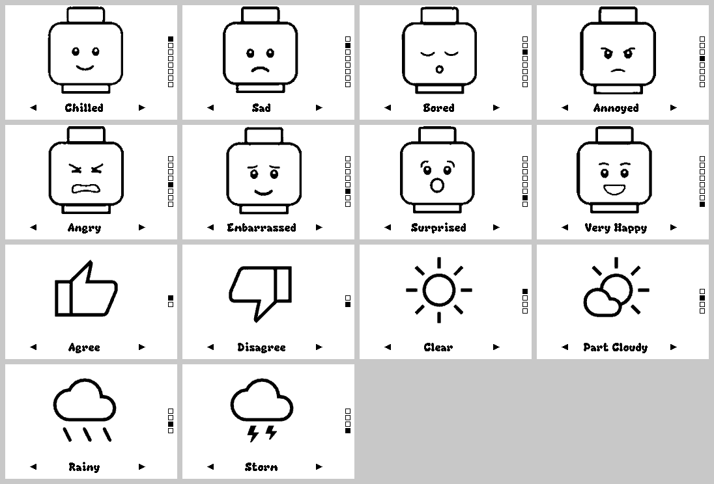

# Badger 2350 Mood Display

Mood Badger is a visual communication aid for neurodivergent children. It turns a Pimoroni [Badger 2350](https://github.com/pimoroni/badger2350) e-ink badge into a mood display: the child presses a button to show how they feel, with a picture and a word, so they can share their emotional state without having to say it. The e-ink screen keeps showing the mood even while the badge is asleep.

Mood Badger 2350 is a port of Simon Painter's [MoodBadger](https://github.com/simonpainter/MoodBadger) for the original Badger 2040, a project I was fortunate to contribute to.



## Install

You need a Badger 2350 running firmware **v3.1.1** or later. Firmware and update steps are on the [Badger 2350 releases page](https://github.com/pimoroni/badger2350/releases/latest).

1. Connect the badge to your computer with a USB-C data cable.
2. Double-tap **RESET** on the back of the badge to enter disk mode. A drive appears; Pimoroni's README calls it `Badger2350` and the Badgeware docs call it `BADGER`.
3. Copy the `badger/mood_badger` folder from this repository into the drive's `apps` folder, giving `/apps/mood_badger`.
4. Safely eject the drive, then press **RESET** once.
5. Choose **Mood Badger** in the menu.

Copying the same folder again later updates the app; your saved mood is kept.

### Copying from a Mac

Finder works, but it also copies the hidden `._` files macOS adds on this kind of drive, and any `__pycache__` folder the tests leave behind. From the repository root, this copies only the app's own files. Use the drive's name as it appears under `/Volumes`:

```sh
rsync -rv --exclude __pycache__ --exclude '.*' badger/mood_badger/ /Volumes/BADGER/apps/mood_badger/
diskutil eject /Volumes/BADGER
```

Keep the trailing `/` on `badger/mood_badger/`, so rsync copies the folder's contents into `apps/mood_badger` rather than nesting a second folder inside it. If no drive appears in disk mode, try another cable: some USB-C cables only carry power.

### Make it the only app

To make the badge a dedicated mood badge that never shows the menu, replace `main.py` at the root of the drive with [`kiosk/main.py`](kiosk/main.py). Install the app as above first, then, with the badge still in disk mode:

```sh
cp -X kiosk/main.py /Volumes/BADGER/main.py
diskutil eject /Volumes/BADGER
```

What changes:

- Power-on, **RESET** and waking from sleep all start Mood Badger.
- **HOME** restarts Mood Badger instead of opening the menu.
- The other apps stay on the drive but cannot be reached from the badge. You can delete their folders from `apps/`; keep `apps/menu` if you might want the menu back.
- Double-tap **RESET** still enters disk mode. The firmware checks for it before running `main.py`, so this cannot lock you out.

To undo it, put the badge in disk mode and copy the stock file back:

```sh
cp -X vendor/badger2350/firmware/main.py /Volumes/BADGER/main.py
```

That file is from firmware v3.1.1; if your badge runs a newer firmware, take `main.py` from that release instead. Updating the firmware may also replace `main.py`. If the menu comes back after an update, copy `kiosk/main.py` over again.

## Controls

| Button | Action |
| --- | --- |
| **UP** | Previous mood |
| **DOWN** | Next mood |
| **A** | Previous mood set, starting at that set's first mood |
| **C** | Next mood set, starting at that set's first mood |
| **B** | Not used |
| **HOME** (back) | Return to the menu (restart Mood Badger when it is [the only app](#make-it-the-only-app)) |
| **RESET** (back) | Restart the badge into the menu (into Mood Badger when it is the only app) |

All five front buttons (A, B, C, UP and DOWN) are available to apps. HOME and RESET belong to the firmware.

Small ◀ and ▶ arrows in the bottom corners of the screen, above **A** and **C**, show that those buttons change the mood set. They are hidden when `config.json` has only one set.

Hold a button until the screen starts to change. E-ink takes a moment to refresh, and the firmware does not read the buttons during a refresh, so a very quick tap at that moment can be missed.

## How power works

The Badger only uses power when the screen changes. Mood Badger draws the chosen mood, saves it, then sleeps after 5 seconds on battery. The e-paper keeps showing the mood while the badge sleeps.

Any front button wakes the badge. It restarts straight back into Mood Badger and acts on the button that woke it, so a single press moves one mood. On USB power the badge never sleeps.

Your choice is saved in `/state/mood_badger.json`, so it survives sleep, HOME, RESET and a flat battery.

## Customising the moods

Moods live in `config.json` inside the app folder. Each set is a list of `[label, image]` pairs, and `initial` (optional) gives the mood each set opens on when you switch to it with **A** or **C**:

```json
{
  "moods": [
    [["Chilled", "happy.png"], ["Sad", "sad.png"]],
    [["Agree", "thumb_up.png"], ["Disagree", "thumb_down.png"]]
  ],
  "initial": [0, 0]
}
```

- Images go in the app's `assets` folder.
- A set holds up to 16 moods, the number of markers that fit down the right edge.
- Keep labels short. Labels use the Ziplock font and must fit between the set arrows; longer ones step down to the smaller Smart font, then Winds.
- If an image is missing, the label still shows. If `config.json` is broken, the badge shows an error that names it.

For your own pictures, any image editor will do: save a 122×136 PNG using black, white and greys. The included images are generated from MoodBadger's JPEGs by `python -m tools.convert_moods`, which fits each one into 122×136 and reduces it to the panel's four greys.

## Differences from MoodBadger (Badger 2040)

| | MoodBadger (Badger 2040) | Mood Badger (Badger 2350) |
| --- | --- | --- |
| Screen | 296×128, black and white | 264×176, black, white and two greys |
| Images | JPEG via `jpegdec` | 4-grey PNG via `image.load` |
| Refresh | TURBO refresh, then a clean-up refresh after 3 seconds | One refresh per change. Firmware v3.1.1 uses the same waveform for every update speed |
| Mood sets | A, B and C jump straight to sets 1, 2 and 3 | A and C step back and forward through any number of sets |
| Third set | A copy of the thumbs set, to give C a shortcut | Weather pictures from MoodBadger's unused images |
| Sleep | `turn_off()` after each change | Badgeware sleep after 5 seconds on battery; a wake restarts the app |
| Saved state | `/state.json` | `/state/mood_badger.json` via Badgeware `State` |
| Install | Copy `main.py` over the badge's main program | A folder app that sits alongside the other apps |

Sprite sheets are not used. A wake draws exactly one picture, so loading one small PNG is faster and lighter than decoding a sheet of every mood, and a caregiver can add a mood by dropping in a file.

## Sharing the app

[`pimoroni/badgeware-contrib`](https://github.com/pimoroni/badgeware-contrib) is where community Badgeware apps are shared, with a folder per badge. There is no installer: people download the repository and copy an app folder to `/apps`, the same as the install steps above.

To contribute Mood Badger:

1. Fork `badgeware-contrib`.
2. Copy `badger/mood_badger` to `Badger/mood_badger`. It already contains `__init__.py`, `icon.png` (24×24) and a README.
3. Check it passes the repository's `ruff` lint (see [Development](#development)).
4. Open a pull request.

The MoodBadger art has no licence yet, and `badgeware-contrib` is MIT-licensed, so the art needs the author's permission or replacing before a pull request.

## The badger.github.io app store

[badger.github.io](https://badger.github.io/) and its [app store](https://badger.github.io/apps/) are for the **GitHub Universe 2026 badge**. That badge is a custom version of Pimoroni's Tufty 2350 with a 320×240 colour screen and different controls. Its 15 preinstalled apps and the store's catalog come from [`badger/home`](https://github.com/badger/home), which only accepts apps tested on that hardware, so it is not a route for this e-ink app.

The store's **Add local app** copies a folder to a badge in disk mode. It has not yet been tried with an e-ink Badger.

A Tufty port of Mood Badger could use `badger/home` or the `Tufty/` folder of `badgeware-contrib`.

## Tufty and Blinky

Mood Badger supports the Badger only. Its siblings, [Tufty 2350](https://github.com/pimoroni/tufty2350) (colour LCD) and [Blinky 2350](https://github.com/pimoroni/blinky2350) (LED matrix), run the same Badgeware API, so a port would mainly need a new layout.

## References

- [badgewa.re](https://badgewa.re): the Badgeware family
- [badgewa.re/docs](https://badgewa.re/docs): guides and API reference
- [try.badgewa.re](https://try.badgewa.re): browser playground (Tufty only)
- [Badger 2350 firmware releases](https://github.com/pimoroni/badger2350/releases/latest)
- [Badger 2350 in the Pimoroni shop](https://shop.pimoroni.com/en-us/products/badger-2350?variant=55801169707387)
- [Badgeware tube status app](https://learn.pimoroni.com/article/badgeware-tube-status-app): Pimoroni Learn tutorial on building a Badgeware app
- [simonpainter/MoodBadger](https://github.com/simonpainter/MoodBadger): the original app
- [Migrating a Badger 2040 app to Badger 2350: MoodBadger](https://forums.pimoroni.com/t/migrating-a-badger2040-app-to-badger2350-moodbadger): Pimoroni forum thread about this port
- [badger.github.io](https://badger.github.io/), [its app store](https://badger.github.io/apps/) and [`badger/home`](https://github.com/badger/home): GitHub Universe 2026 badge
- [All Pimoroni Badgeware repositories](https://github.com/orgs/pimoroni/repositories?q=badgeware)

| Repository | Use here |
| --- | --- |
| [`badger2350`](https://github.com/pimoroni/badger2350) | E-ink firmware and stock apps; the source of truth for behaviour |
| [`badgeware-docs`](https://github.com/pimoroni/badgeware-docs) | Source of the `badgewa.re/docs` site |
| [`badgeware-contrib`](https://github.com/pimoroni/badgeware-contrib) | Community apps; where to share Mood Badger |
| [`badgeware-wasm`](https://github.com/pimoroni/badgeware-wasm) | WebAssembly simulator with a Badger variant; used by `sim/` |
| [`badgeware-simulator`](https://github.com/pimoroni/badgeware-simulator) | Native desktop simulator |
| [`badgeware-web-simulator`](https://github.com/pimoroni/badgeware-web-simulator) | Browser simulator at `try.badgewa.re`, Tufty only |
| [`badgeware-ide`](https://github.com/pimoroni/badgeware-ide) | Prototype browser IDE, Tufty only |
| [`picovector-micropython`](https://github.com/pimoroni/picovector-micropython) | Graphics engine behind `image`, `screen` and `shape` |
| [`badgeware-fonts`](https://github.com/pimoroni/badgeware-fonts) | Builds fonts for Badgeware |
| [`badgeware-cpp`](https://github.com/pimoroni/badgeware-cpp) | C++ alternative to MicroPython; not used here |
| [`tufty2350`](https://github.com/pimoroni/tufty2350), [`blinky2350`](https://github.com/pimoroni/blinky2350) | Firmware for the other badges |

## Development

`vendor/` holds two pinned submodules: `badger2350` at `v3.1.1` (the firmware, for reference and the simulator) and `MoodBadger` (the source art).

```sh
git submodule update --init
python3 -m venv .venv
.venv/bin/pip install -r requirements-dev.txt
```

| Task | Command |
| --- | --- |
| Run the tests | `.venv/bin/pytest` |
| Check MicroPython syntax | `.venv/bin/python -m mpy_cross -o /dev/null badger/mood_badger/__init__.py` (and `moods.py`) |
| Lint as `badgeware-contrib` does | `.venv/bin/ruff check --config vendor/badger2350/ci/ruff.toml badger/mood_badger` |
| Regenerate images | `.venv/bin/python -m tools.convert_moods` |

The app's logic is in `moods.py`, which has no Badgeware dependencies. `__init__.py` is the Badgeware layer, tested against a recording fake in `tests/fake_badgeware.py`.

### Simulator

`sim/` runs the real firmware Python and the unmodified app in the Badger build of [`badgeware-wasm`](https://github.com/pimoroni/badgeware-wasm):

```sh
python3 sim/stage.py
python3 -m http.server -d sim/dist 8000
```

Open <http://localhost:8000/>. Arrow keys are UP and DOWN; `a`, `b`, `c` and `h` are A, B, C and HOME. The page always loads fresh app files, so after re-staging a normal reload shows your changes. `tests/test_sim.py` runs the same build headless under Node.

The simulator shows layout, art, labels and navigation. It does not model sleep, waking, refresh time or how the e-paper looks, so check those on a real badge. `sim/wasm/SOURCE.md` says where the wasm build came from and how to update it.

## Licence

The code in this repository is released under the [MIT Licence](LICENSE).

The licence does not cover the mood images (`badger/mood_badger/assets/`, `icon.png` and the simulator screenshot). They are derived from Simon Painter's MoodBadger art, which has no licence and is not cleared for redistribution. `sim/wasm/` is Pimoroni's MIT-licensed `badgeware-wasm` build, and the `vendor/` submodules keep their own licences.
