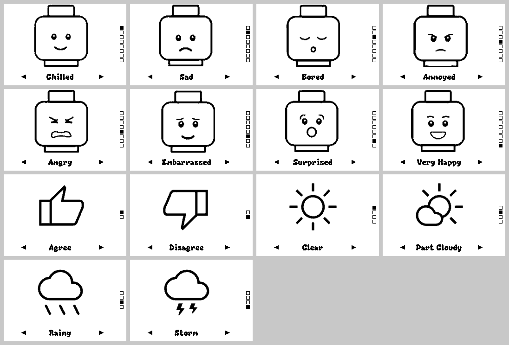

# Badger 2350 and Tufty 2350 Mood Display

Mood Badger is a visual communication aid for neurodivergent children. It turns a Pimoroni [Badger 2350](https://github.com/pimoroni/badger2350) e-ink badge into a mood display: the child presses a button to show how they feel, with a picture and a word, so they can share their emotional state without having to say it. The e-ink screen keeps showing the mood even while the badge is asleep.

The same app also runs on the colour-screen [Tufty 2350](https://github.com/pimoroni/tufty2350), showing the same pictures larger. See [Badger or Tufty](#badger-or-tufty) for how the two behave differently.

Mood Badger 2350 is a port of Simon Painter's [MoodBadger](https://github.com/simonpainter/MoodBadger) for the original Badger 2040, a project I was fortunate to contribute to.



## Badger or Tufty

One app folder, `badger/mood_badger`, runs on both badges with the same moods, pictures and buttons. It checks which badge it is on when it starts. Each badge keeps its own saved mood.

|                            | Badger 2350                                                        | Tufty 2350                                                                                                |
| -------------------------- | ------------------------------------------------------------------ | --------------------------------------------------------------------------------------------------------- |
| Screen                     | 264×176 e-ink; keeps showing the mood with the power off           | 320×240 colour LCD with a backlight; pictures shown 1.5× larger, in the same black and white              |
| Pressing a button          | The screen takes a moment to change; hold the button until it does | Changes at once, unless the screen is dimmed (below)                                                      |
| When left alone            | Sleeps after 5 seconds on battery; never on USB                    | Dims after 10 seconds: to about half on USB, about 15% on battery. Never goes dark and never sleeps       |
| The first press after that | Wakes the badge **and** moves one mood                             | Only brightens the screen; the next press changes the mood                                                |
| Battery                    | Lasts a long time: power is only used when the mood changes        | Hours rather than days, because the screen is lit and redrawn continuously (not yet measured)             |
| Turning it off             | Not needed; it sleeps by itself                                    | Hold **RESET** until the case lights fade; any front button turns it on                                   |
| What it opens at start-up  | Waking from sleep returns to Mood Badger; RESET opens the menu     | Pimoroni's menu, unless installed in start-in-app mode. See [What the badge opens](#what-the-badge-opens) |
| Disk-mode drive            | `BADGER`                                                           | `TUFTY`                                                                                                   |

## Install

You need a Badger 2350 or Tufty 2350 running firmware **v3.1.1** or later. Firmware and update steps are on the [Badger 2350](https://github.com/pimoroni/badger2350/releases/latest) and [Tufty 2350](https://github.com/pimoroni/tufty2350/releases/latest) releases pages; `python3 -m tools.badge_info` ([below](#using-the-install-tools)) shows whether yours is current. The steps are the same on both badges; only the drive name differs. On a Tufty, also set it to open Mood Badger at start-up: see [What the badge opens](#what-the-badge-opens).

1. Download this repository (on GitHub, **Code** > **Download ZIP**) and unzip it.
2. Connect the badge to your computer with a USB-C data cable.
3. Double-tap **RESET** on the back of the badge to enter disk mode (or open **Mass Storage** in the badge's menu). A drive appears: `BADGER` on a Badger, `TUFTY` on a Tufty.
4. Copy the `badger/mood_badger` folder into the drive's `apps` folder, giving `/apps/mood_badger`.
5. Safely eject the drive, then press **RESET** once.
6. Choose **Mood Badger** in the menu.

Copying the same folder again later updates the app; your saved mood is kept.

### Copying from a Mac

Finder works, but it also copies the hidden `._` files macOS adds on this kind of drive, and any `__pycache__` folder the tests leave behind. From the repository root, this copies only the app's own files. Use the drive's name as it appears under `/Volumes` (`TUFTY` on a Tufty):

```sh
rsync -rv --exclude __pycache__ --exclude '.*' badger/mood_badger/ /Volumes/BADGER/apps/mood_badger/
diskutil eject /Volumes/BADGER
```

Keep the trailing `/` on `badger/mood_badger/`, so rsync copies the folder's contents into `apps/mood_badger` rather than nesting a second folder inside it. If no drive appears in disk mode, try another cable: some USB-C cables only carry power.

### Using the install tools

The repository's `tools/` has four scripts for a badge on USB. Run them from the repository root with Python 3; they work on macOS, Linux and Windows. All but `install` talk to the badge over USB with `mpremote` (`pip install mpremote`; the development setup below installs it). `--eject` works on macOS and Linux; on Windows, eject the drive from Explorer.

| Command                                                                               | Badge mode                                                    | What it does                                                                                                                                                                                                                                                                                                                                                                                  |
| ------------------------------------------------------------------------------------- | ------------------------------------------------------------- | --------------------------------------------------------------------------------------------------------------------------------------------------------------------------------------------------------------------------------------------------------------------------------------------------------------------------------------------------------------------------------------------- |
| `python3 -m tools.badge_info`                                                         | Normal (press **RESET** once)                                 | Shows the model, whether the firmware is the latest release, whether Mood Badger is installed and what the badge starts up into (the menu, kiosk or start-in-app). Interrupts the running app to read the badge, then restarts it                                                                                                                                                             |
| `python3 -m tools.install --eject`                                                    | Disk (double-tap **RESET**)                                   | Copies only the app's files (no `__pycache__`, and it deletes the hidden `._` files macOS writes), removes files the app no longer has, checks the copy and ejects. It builds the copy beside `apps/` and swaps it in at the end, so an interrupted copy leaves the old app working. Add `--start-in-app` (Tufty), `--kiosk` or `--menu` to set [what the badge opens](#what-the-badge-opens) |
| `python3 -m tools.flash_firmware --model badger --firmware-only` (or `--model tufty`) | Bootloader (hold **BOOT**, tap **RESET**, let go of **BOOT**) | Downloads the latest firmware for that model and flashes it, keeping apps and files. Use the model `badge_info` reports: the other model's firmware won't run. `--with-filesystem` instead resets every app and file to Pimoroni's defaults                                                                                                                                                   |
| `python3 -m tools.badge_check files`                                                  | Normal                                                        | After an install, checks that the app on the badge matches this repository. `wake-reason` shows why the badge last restarted. Both restart the badge afterwards                                                                                                                                                                                                                               |

Each takes `--wait SECONDS`, which keeps looking for the badge that long, so you can start the command and then press the buttons.

In Claude Code, the `badge-deploy`, `badge-firmware` and `badge-verify` skills run these for you and say which buttons to press.

## What the badge opens

Both badges start up in Pimoroni's menu of apps unless told otherwise. What each one does next:

- **Badger:** it comes back to Mood Badger by itself. Waking from sleep reopens the last app used, so once Mood Badger has been opened, it stays. **RESET** and **HOME** open the menu.
- **Tufty:** it needs one extra install step. Its stock start-up always opens the menu, so install it in **start-in-app mode** (below), the normal Tufty setup. Then power-on and **RESET** open Mood Badger, and **HOME** opens the menu.

**Kiosk mode** goes one step further on either badge: Mood Badger is the only app, and the menu is never shown.

|                                 | Badger (stock)              | Tufty, start-in-app        | Tufty (stock)              | Kiosk mode (either) |
| ------------------------------- | --------------------------- | -------------------------- | -------------------------- | ------------------- |
| Install option                  | none (`--menu` to go back)  | `--start-in-app`           | none (`--menu` to go back) | `--kiosk`           |
| Power-on, or waking             | Last app used (Mood Badger) | Mood Badger                | Menu                       | Mood Badger         |
| **RESET**                       | Menu                        | Mood Badger                | Menu                       | Mood Badger         |
| **HOME**                        | Menu                        | Menu                       | Menu                       | Mood Badger         |
| After installing with the tools | Last app used*              | Menu: press **RESET** once | Menu                       | Mood Badger*        |

Checked on real badges: the whole start-in-app column, and power-on, waking and **HOME** on a Badger. Cells marked \* come from the firmware source and haven't been seen on a badge, and kiosk mode hasn't been tried on a Tufty. The `badgeware-platforms` Claude Code skill keeps the record of what was checked.

Each setting is a `main.py` at the root of the badge's drive; the app itself is the same. Double-tap **RESET** still enters disk mode in every setting, because the firmware checks for it before running `main.py`, so none of them can lock you out. Updating the firmware with its filesystem image replaces `main.py` with the stock one; install the setting again afterwards.

### Tufty: start-in-app mode

With the Tufty in disk mode:

```sh
python3 -m tools.install --start-in-app --eject
```

Or copy the file yourself, after installing the app:

```sh
cp -X kiosk/start_in_app.py /Volumes/TUFTY/main.py
```

This replaces `main.py` with [`kiosk/start_in_app.py`](kiosk/start_in_app.py), which opens the menu only when the badge was restarted by **HOME**, and Mood Badger otherwise. Two other things restart a Tufty the same way as **HOME**, so they also show the menu: finishing an install, and the badge tools (`badge_info`, `badge_check`). Press **RESET** once to get Mood Badger back. The Badger doesn't need this mode (it already returns to Mood Badger when it wakes), so the installer refuses it there.

### Kiosk mode: Mood Badger only

Kiosk mode works on both badges. With the badge in disk mode:

```sh
python3 -m tools.install --kiosk --eject
```

Or copy [`kiosk/main.py`](kiosk/main.py) over `main.py` yourself, after installing the app:

```sh
cp -X kiosk/main.py /Volumes/BADGER/main.py      # Badger
cp -X kiosk/main.py /Volumes/TUFTY/main.py       # Tufty
```

Then eject the drive. What changes:

- Power-on, **RESET**, **HOME** and (on the Badger) waking from sleep all start Mood Badger.
- On a Tufty, kiosk mode replaces start-in-app mode: **HOME** no longer opens the menu.
- The other apps stay on the drive but can't be reached from the badge. You can delete their folders from `apps/`; keep `apps/menu` if you might want the menu back.

### Back to the menu

```sh
python3 -m tools.install --menu --eject
```

This restores that badge's own stock `main.py`. To do it by hand, copy the right one back in disk mode:

```sh
cp -X vendor/badger2350/firmware/main.py /Volumes/BADGER/main.py   # Badger
cp -X vendor/tufty2350/firmware/main.py /Volumes/TUFTY/main.py     # Tufty
```

Those files are from firmware v3.1.1; if your badge runs a newer firmware, take `main.py` from that release instead.

## Controls

| Button           | Action                                                                                                                                                                                  |
| ---------------- | --------------------------------------------------------------------------------------------------------------------------------------------------------------------------------------- |
| **UP**           | Previous mood                                                                                                                                                                           |
| **DOWN**         | Next mood                                                                                                                                                                               |
| **A**            | Previous mood set, opening on its `initial` mood (the first by default). Does nothing with only one set                                                                                 |
| **C**            | Next mood set, opening on its `initial` mood (the first by default). Does nothing with only one set                                                                                     |
| **B**            | Not used                                                                                                                                                                                |
| **HOME** (back)  | Return to the menu (restart Mood Badger in [kiosk mode](#kiosk-mode-mood-badger-only))                                                                                                  |
| **RESET** (back) | Restart the badge: into the menu, or Mood Badger in kiosk mode and on a Tufty in start-in-app mode (see [What the badge opens](#what-the-badge-opens)). Hold it on a Tufty to power off |

All five front buttons (A, B, C, UP and DOWN) are available to apps. HOME and RESET belong to the firmware.

Small ◀ and ▶ arrows in the bottom corners of the screen, above **A** and **C**, show that those buttons change the mood set. With only one set in `config.json`, the arrows are hidden and **A** and **C** do nothing.

On a Badger, hold a button until the screen starts to change. E-ink takes a moment to refresh, and a very quick tap during a refresh can be missed. On a Tufty the screen changes at once, but when it is dimmed the first press only brightens it.

## How power works

### Badger 2350

The Badger only uses power when the screen changes. Mood Badger draws the chosen mood, saves it, then sleeps after 5 seconds on battery. The e-paper keeps showing the mood while the badge sleeps.

Any front button wakes the badge. It restarts straight back into Mood Badger and acts on the button that woke it, so a single press moves one mood. On USB power the badge never sleeps.

### Tufty 2350

The Tufty's screen needs its backlight to be seen, so Mood Badger never puts it to sleep. Instead it dims the backlight after 10 seconds without a press: to about half on USB power, and to about 15% on battery, where it changes as soon as the cable is unplugged. The mood stays visible while dimmed.

The first press on a dimmed screen only brightens it, so the child sees the current mood before changing it; the next press changes the mood. The press that turns the badge on works the same way.

Because the screen stays lit, a Tufty on battery runs for hours rather than days (an estimate; not yet measured). Turn it off by holding **RESET** on the back until the case lights fade; any front button turns it on again, back in Mood Badger in [start-in-app mode](#tufty-start-in-app-mode).

### Both

Your choice is saved in `/state/mood_badger.json`, so it survives sleep, power-off, HOME, RESET and a flat battery. Each badge keeps its own.

## Customising the moods

Moods live in `config.json` inside the app folder. Each set is a list of `[label, image]` pairs, and `initial` (optional) gives the mood each set opens on when you switch to it with **A** or **C**:

```json
{
  "moods": [
    [
      ["Chilled", "fig_chilled.png"],
      ["Sad", "fig_sad.png"]
    ],
    [
      ["Agree", "thumb_up.png"],
      ["Disagree", "thumb_down.png"]
    ]
  ],
  "initial": [0, 0]
}
```

- Images go in the app's `assets` folder.
- Image names start with a prefix for their set: `sent_` (Material faces), `fig_` (Lego figures), `thumb_` and `day_` (weather).
- A set holds up to 16 moods, the number of markers that fit down the right edge.
- Keep labels short. Labels use the large Ignore font and must fit between the set arrows (about 11 letters); longer ones step down to Ziplock, then the smaller Smart and Winds fonts.
- If an image is missing, the label still shows. If `config.json` is broken, the badge shows an error that names it.

### Adding or removing sets

The sets appear in the order they are listed in `moods`, and **A** and **C** step through them, wrapping round at either end.

- **Add a set:** copy its images into `assets/` with a new prefix, such as `team_`, and add a list of `[label, image]` pairs to `moods`. If you use `initial`, add an entry for the new set in the same position; a missing entry opens the set on its first mood.
- **Remove a set:** delete its list from `moods` and its entry from `initial`. You can also delete its images from `assets/` to save space on the badge, since unused images are still copied across.
- **Reorder sets:** move the lists within `moods`, and move the `initial` entries to match.

To keep a single set, list only that one. The ◀ ▶ arrows are hidden and **A** and **C** do nothing, leaving **UP** and **DOWN** to step through the moods:

```json
{
  "moods": [
    [
      ["Chilled", "sent_chilled.png"],
      ["Sad", "sent_sad.png"],
      ["Angry", "sent_angry.png"]
    ]
  ]
}
```

The badge remembers the set by its position in the list. If that position no longer exists, it starts on the first set. If you removed or moved an earlier set, it may open on a different set; press **A** or **C** to move.

For your own pictures, any image editor will do: save a 122×136 PNG using black, white and greys. The included images are generated by `python -m tools.convert_moods`, which reduces each one to the panel's four greys. It fits MoodBadger's JPEGs into 122×136, and draws the `sent_*` faces from Google's [Material Symbols](https://fonts.google.com/icons) font (outlined, weight 300) at the same 100 px width as the weather pictures. It downloads the font into `.cache/` the first time.

## Differences from MoodBadger (Badger 2040)

|                | MoodBadger (Badger 2040)                               | Mood Badger (Badger 2350)                                                                                                                   |
| -------------- | ------------------------------------------------------ | ------------------------------------------------------------------------------------------------------------------------------------------- |
| Screen         | 296×128, black and white                               | 264×176, black, white and two greys                                                                                                         |
| Images         | JPEG via `jpegdec`                                     | 4-grey PNG via `image.load`                                                                                                                 |
| Refresh        | TURBO refresh, then a clean-up refresh after 3 seconds | One refresh per change. Firmware v3.1.1 uses the same waveform for every update speed                                                       |
| Mood sets      | A, B and C jump straight to sets 1, 2 and 3            | A and C step back and forward through any number of sets                                                                                    |
| Third set      | A copy of the thumbs set, to give C a shortcut         | Weather pictures from MoodBadger's unused images                                                                                            |
| Material faces | None                                                   | The first set: Material Symbols sentiment faces in the same outline style as the thumbs and weather, which may later replace the Lego faces |
| Sleep          | `turn_off()` after each change                         | Badgeware sleep after 5 seconds on battery; a wake restarts the app                                                                         |
| Saved state    | `/state.json`                                          | `/state/mood_badger.json` via Badgeware `State`                                                                                             |
| Install        | Copy `main.py` over the badge's main program           | A folder app that sits alongside the other apps                                                                                             |

Sprite sheets are not used. A wake draws exactly one picture, so loading one small PNG is faster and lighter than decoding a sheet of every mood, and a caregiver can add a mood by dropping in a file.

## Sharing the app

[`pimoroni/badgeware-contrib`](https://github.com/pimoroni/badgeware-contrib) is where community Badgeware apps are shared, with a folder per badge. There is no installer: people download the repository and copy an app folder to `/apps`, the same as the install steps above.

To contribute Mood Badger:

1. Fork `badgeware-contrib`.
2. Copy `badger/mood_badger` to `Badger/mood_badger`, and to `Tufty/mood_badger` for the Tufty (the same folder runs on both). It already contains `__init__.py`, `icon.png` (24×24) and a README.
3. Check it passes the repository's `ruff` lint (see [Development](#development)).
4. Open a pull request.

The mood images are Google Material icons under the Apache License 2.0, and the app folder already carries that licence in `assets/LICENSE`, so they can be contributed as they are.

## The badger.github.io app store

[badger.github.io](https://badger.github.io/) and its [app store](https://badger.github.io/apps/) are for the **GitHub Universe 2026 badge**. That badge is a custom version of Pimoroni's Tufty 2350 with a 320×240 colour screen and different controls. Its 15 preinstalled apps and the store's catalog come from [`badger/home`](https://github.com/badger/home), which only accepts apps tested on that hardware. The Badger version can't go there; the Tufty version could, once it has been tested on that badge, which it hasn't.

The store's **Add local app** copies a folder to a badge in disk mode. It hasn't been tried with Mood Badger.

## Blinky 2350

The [Blinky 2350](https://github.com/pimoroni/blinky2350) (LED matrix) runs the same Badgeware API as the Badger and [Tufty 2350](https://github.com/pimoroni/tufty2350), but Mood Badger doesn't support it: an LED matrix can't show the pictures as they are, so it would need its own design.

## References

- [badgewa.re](https://badgewa.re): the Badgeware family
- [badgewa.re/docs](https://badgewa.re/docs): guides and API reference
- [try.badgewa.re](https://try.badgewa.re): browser playground (Tufty only)
- [Badger 2350 firmware releases](https://github.com/pimoroni/badger2350/releases/latest)
- [Badger 2350 in the Pimoroni shop](https://shop.pimoroni.com/en-us/products/badger-2350?variant=55801169707387)
- [Badgeware tube status app](https://learn.pimoroni.com/article/badgeware-tube-status-app): Pimoroni Learn tutorial on building a Badgeware app
- [simonpainter/MoodBadger](https://github.com/simonpainter/MoodBadger): the original app
- [Migrating a Badger 2040 app to Badger 2350: MoodBadger](https://forums.pimoroni.com/t/migrating-a-badger2040-app-to-badger2350-moodbadger): Pimoroni forum thread about this port
- [badger.github.io](https://badger.github.io/), [its app store](https://badger.github.io/apps/) and [`badger/home`](https://github.com/badger/home): GitHub Universe 2026 badge
- [All Pimoroni Badgeware repositories](https://github.com/orgs/pimoroni/repositories?q=badgeware)

| Repository                                                                                                   | Use here                                                             |
| ------------------------------------------------------------------------------------------------------------ | -------------------------------------------------------------------- |
| [`badger2350`](https://github.com/pimoroni/badger2350)                                                       | E-ink firmware and stock apps; the source of truth for behaviour     |
| [`badgeware-docs`](https://github.com/pimoroni/badgeware-docs)                                               | Source of the `badgewa.re/docs` site                                 |
| [`badgeware-contrib`](https://github.com/pimoroni/badgeware-contrib)                                         | Community apps; where to share Mood Badger                           |
| [`badgeware-wasm`](https://github.com/pimoroni/badgeware-wasm)                                               | WebAssembly simulator with Badger and Tufty variants; used by `sim/` |
| [`badgeware-simulator`](https://github.com/pimoroni/badgeware-simulator)                                     | Native desktop simulator                                             |
| [`badgeware-web-simulator`](https://github.com/pimoroni/badgeware-web-simulator)                             | Browser simulator at `try.badgewa.re`, Tufty only                    |
| [`badgeware-ide`](https://github.com/pimoroni/badgeware-ide)                                                 | Prototype browser IDE, Tufty only                                    |
| [`picovector-micropython`](https://github.com/pimoroni/picovector-micropython)                               | Graphics engine behind `image`, `screen` and `shape`                 |
| [`badgeware-fonts`](https://github.com/pimoroni/badgeware-fonts)                                             | Builds fonts for Badgeware                                           |
| [`badgeware-cpp`](https://github.com/pimoroni/badgeware-cpp)                                                 | C++ alternative to MicroPython; not used here                        |
| [`tufty2350`](https://github.com/pimoroni/tufty2350), [`blinky2350`](https://github.com/pimoroni/blinky2350) | Firmware for the other badges                                        |

## Development

`vendor/` holds three pinned submodules: `badger2350` and `tufty2350`, both at `v3.1.1` (the firmware, for reference and the simulator), and `MoodBadger` (the source art).

```sh
git submodule update --init
python3 -m venv .venv
.venv/bin/pip install -r requirements-dev.txt
git config core.hooksPath .githooks   # once per clone: check Markdown formatting before each commit
```

The pre-commit hook needs Node.js (`npx`). GitHub Actions (`.github/workflows/ci.yml`) runs the lint, syntax, test and Markdown checks below on every pull request and push to `main`.

| Task                                     | Command                                                                                                 |
| ---------------------------------------- | ------------------------------------------------------------------------------------------------------- |
| Run the tests                            | `.venv/bin/pytest`                                                                                      |
| Check MicroPython syntax                 | `for f in badger/mood_badger/*.py kiosk/*.py; do .venv/bin/python -m mpy_cross -o /dev/null "$f"; done` |
| Lint with Pimoroni's rules (`ruff.toml`) | `.venv/bin/ruff check .`                                                                                |
| Format Markdown                          | `npx --yes prettier@3.9.10 --write <files>`                                                             |
| Regenerate images                        | `.venv/bin/python -m tools.convert_moods`                                                               |

The app's logic is in `moods.py`, which has no Badgeware dependencies. `__init__.py` is the Badgeware layer, tested against a recording fake in `tests/fake_badgeware.py`.

### Testing

The app is a communication aid a child relies on, and the Badger is in real use, so a change is verified in layers, fastest first. Each layer catches things the one before it can't.

| Layer                 | Command                                                                                                                                                                            | Catches                                                                                                                                                                                                  | Misses                                                          |
| --------------------- | ---------------------------------------------------------------------------------------------------------------------------------------------------------------------------------- | -------------------------------------------------------------------------------------------------------------------------------------------------------------------------------------------------------- | --------------------------------------------------------------- |
| 1. Unit tests         | `.venv/bin/pytest`                                                                                                                                                                 | Logic, saving, button and backlight rules, using a Badger-only name on the Tufty. `run_app(..., model="tufty", usb=[...])` in `tests/fake_badgeware.py` runs the real app against a fake of either badge | Anything the fake doesn't model: real drawing, timing, hardware |
| 2. MicroPython checks | `mpy_cross` and `ruff` (table above)                                                                                                                                               | Syntax MicroPython rejects, undefined Badgeware names                                                                                                                                                    | Behaviour                                                       |
| 3. Headless simulator | `python3 sim/stage.py && node sim/run_headless.mjs --model tufty --press DOWN --frames out.json` (also run by layer 1 when `node` is installed)                                    | The real firmware Python drawing the real app on each badge: pixels, layout, colours                                                                                                                     | Sleep, waking, restart reasons, battery, e-ink refresh          |
| 4. Browser simulator  | See [Simulator](#simulator); open `/badger/` and `/tufty/`                                                                                                                         | What a person notices: does it look right?                                                                                                                                                               | As layer 3                                                      |
| 5. Real badges        | `python3 -m tools.badge_info`, `python3 -m tools.install --wait 180 --eject`, `python3 -m tools.badge_check files`, `python3 -m tools.badge_check wake-reason --after-restart 180` | Firmware, the installed copy as the badge sees it, restart reasons, power, how it feels to use                                                                                                           | -                                                               |

`tools.badge_check files` compares the app on the badge (read over USB after the eject) with `badger/mood_badger`, and lists any `._` or `__pycache__` files it finds as "macOS junk"; `wake-reason` reports why the badge last restarted, optionally waiting for you to press RESET or HOME first. Both stop the running app and restart the badge: a Badger reopens the app it was showing, and a Tufty in start-in-app mode shows the menu (RESET brings Mood Badger back).

Which layers a change needs, and the hand checklists for each badge, are in the `badge-verify` Claude Code skill (`.claude/skills/badge-verify/SKILL.md`), which is also readable as a plain checklist. In short: app code needs every layer on both badges; `moods.py`-only changes need layers 1 and 2; boot files need a wake-reason check on the badge.

### Simulator

`sim/` runs the real firmware Python and the unmodified app in the Badger and Tufty builds of [`badgeware-wasm`](https://github.com/pimoroni/badgeware-wasm):

```sh
python3 sim/stage.py
python3 -m http.server -d sim/dist 8000
```

Open <http://localhost:8000/> and choose the Badger (`/badger/`) or the Tufty (`/tufty/`). Arrow keys are UP and DOWN; `a`, `b`, `c` and `h` are A, B, C and HOME. The page always loads fresh app files, so after re-staging a normal reload shows your changes. `tests/test_sim.py` runs both builds headless under Node (`node sim/run_headless.mjs --model tufty ...`).

The simulator shows layout, art, labels and navigation. It does not model sleep, waking, refresh time or how the e-paper looks, or the Tufty's battery power (it always dims to the USB level), so check those on a real badge. `sim/wasm/SOURCE.md` says where the wasm build came from and how to update it.

### Claude Code

The repository is set up for [Claude Code](https://claude.com/claude-code). `CLAUDE.md` holds the project instructions, and `.claude/settings.json` enables the plugins below from the `anthropics/claude-plugins-official` marketplace. Claude Code offers to install them when you trust the folder; `CLAUDE.md` gives the commands to install them by hand.

| Plugin                 | Used for                                                                |
| ---------------------- | ----------------------------------------------------------------------- |
| `superpowers`          | Brainstorming, plans, test-driven development, debugging, code review   |
| `skill-creator`        | Creating and improving project skills under `.claude/skills/`           |
| `claude-md-management` | Checking `CLAUDE.md` against the code and saving what a session learned |

Project skills in `.claude/skills/`: `badge-deploy` (install the app), `badge-firmware` (check and flash firmware), `badge-verify` (the [testing](#testing) layers and hand checklists) and `badgeware-platforms` (how the Badger and Tufty differ, with firmware references).

Personal permission rules, such as commands Claude may run without asking, go in `.claude/settings.local.json`, which is not committed.

## Licence

The code in this repository is released under the [MIT Licence](LICENSE).

The mood images (`badger/mood_badger/assets/`, `icon.png` and the simulator screenshot) are [Google Material icons](https://fonts.google.com/icons), which MoodBadger exported as images and this repository converts to four greys; the `sent_*` faces are drawn here from the Material Symbols font. They are licensed under the Apache License 2.0, included as `badger/mood_badger/assets/LICENSE`. `sim/wasm/` is Pimoroni's MIT-licensed `badgeware-wasm` build, and the `vendor/` submodules keep their own licences.
